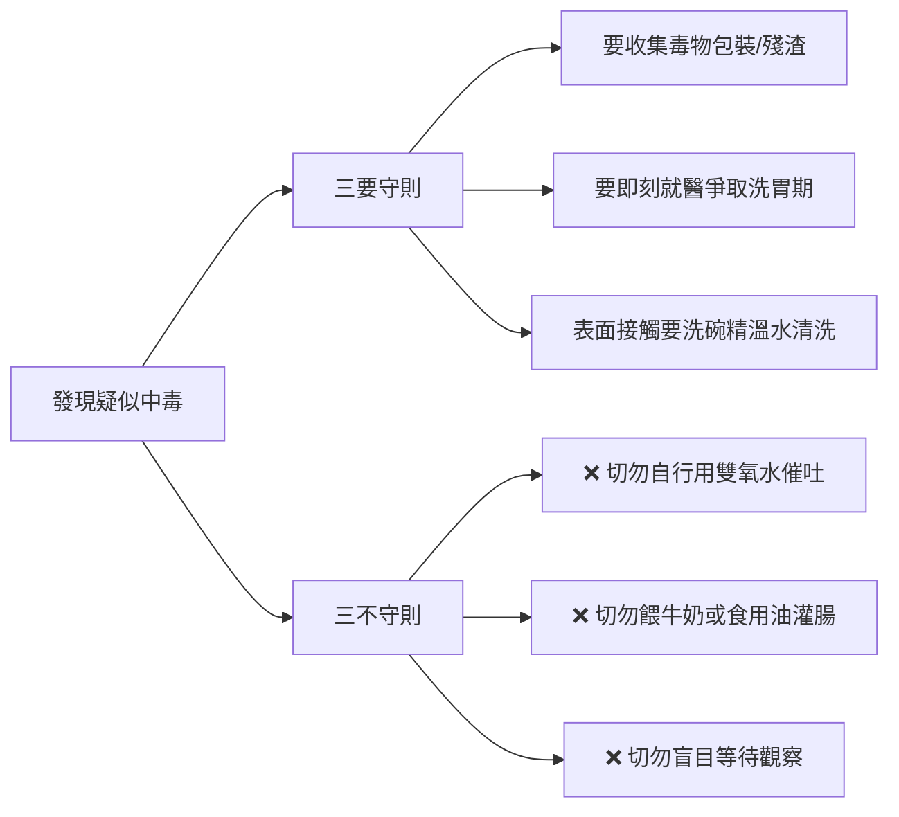

# 居家中毒危險物質與致命毒理指南

貓咪是嚴格肉食動物，體內缺乏關鍵肝臟代謝酶（**葡萄糖醛酸轉移酶 UGT1A6/1A9**），無法有效排除酚類、苯甲酸類與多種人類藥物，致使極微小劑量即可奪命。

---

## 一、 致命性極毒清單（飼主絕對零容忍）

### 1. ☠️ 百合屬與萱草屬植物（Lilies）
- **致死物**：香水百合、鐵炮百合、金針花、火百合。
- **毒性部位**：全株有毒！包含花粉、葉片、花瓣、花粉掉落舔毛、甚至喝花瓶裡的水。
- **病理危害**：引發急速壞死性**急性腎小管損傷（AKI）**。
- **搶救窗口**：**18 小時內為生死界限**。若未在黃金期內送醫給予靜脈擴容利尿，48-72 小時內將進入無尿性腎衰竭而亡。

### 2. ☠️ 百滅寧 / 除蟲菊精（Permethrin）
- **常見途徑**：誤用「狗用」體外驅蟲滴劑、家用殺蟲水霧。
- **症狀**：耳朵與面部肌肉顫搐、全身肌肉震顫（Tremors）、運動失調、體溫過高、抽搐發作。
- **緊急對策**：即刻以溫水中性洗碗精洗除毛皮殘油，送醫施打肌肉鬆弛劑（Methocarbamol）。

### 3. ☠️ 對乙醯氨基酚（Acetaminophen / 普拿疼）
- **危害**：貓體內無法解毒，代謝物導致**變性血紅素血症（Methemoglobinemia）**與急性肝壞死。
- **症狀**：口腔黏膜呈暗褐色/巧克力色、呼吸窘迫窒息、面部水腫。
- **解毒劑**：乙醯半胱氨酸（NAC）高劑量搶救。

---

## 二、 居家高危環境因子速查對照表

| 類別 | 危險品名 | 傷害機轉 | 臨床特徵 | 安全預防原則 |
| :--- | :--- | :--- | :--- | :--- |
| **觀葉植物** | 黃金葛、龜背竹、蔓綠絨 | 針狀不溶性草酸鈣結晶 | 口腔劇烈灼痛、流口水、嘔吐、吞嚥困難 | 移入隔離陽台，改種小麥草/貓草 |
| **芳香精油** | 茶樹、尤加利、薄荷、柑橘精油 | 脂溶性揮發烴累積肝臟 | 運動失調、流口水、中樞抑制、肝指數爆表 | 養貓空間嚴禁高濃度水氧機擴香 |
| **人類藥物** | 布洛芬 (Ibuprofen)、阿斯匹靈 | 抑制 COX-1 酵素 | 消化道穿孔大出血、急性腎壞死 | 藥品鎖入抽屜，切勿餵人藥止痛 |
| **人類食物** | 洋蔥、大蒜、青蔥、巧克力 | 有機硫化物引發溶血 | 海因茲小體性溶血性貧血、血尿 | 鮮食禁用任何蔥蒜調味 |

---

## 三、 疑似中毒時的「三要三不」黃金急救守則

- **❌ 絕對不要自行灌雙氧水（$3\% \text{ H}_2\text{O}_2$）催吐**：貓食道極脆弱，自行催吐常誘發嚴重的腐蝕性食道炎與吸入性化學肺炎。
- **✅ 立即打包毒物證據送醫**：外包裝、吃剩的花草殘根、嘔吐物拍照，交由急診獸醫判讀。

---

## 相關頁面連結
- [[慢性腎臟病_CKD]]：百合中毒後倖存貓咪高機率留下不可逆的慢性腎損傷。
- [[貓咪急症紅旗信號總覽]]：巧克力黏膜發紺與神經抽搐之急診等級。
- [[貓咪疼痛評估與面部表情量表_FGS]]：辨別中毒性腹痛與嘔吐前不適。
