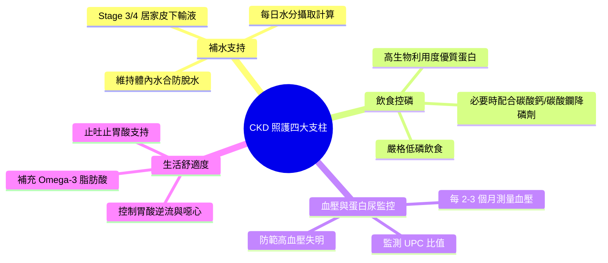

# 貓慢性腎臟病 (CKD) 國際 IRIS 分期與全方位照護

慢性腎臟病（Chronic Kidney Disease, CKD）是 7 歲以上熟齡貓最普遍的進行性慢性疾病。7 歲以上貓約 $30\%$、15 歲以上高齡貓高達 $60\% \sim 80\%$ 罹患此病。受損壞死的腎元無法再生，治療重點在於「**早期發現、減輕殘存腎元負擔、控制併發症、維持生活品質**」。

---

## 一、 國際 IRIS 2023 分期金標準

國際腎臟權益學會（IRIS）依據**空腹平穩狀態**下的血清肌酸酐（Blood Creatinine）與對稱二甲基精胺酸（SDMA）分為四期：

| IRIS 分期 | 血清肌酸酐 (Creatinine, mg/dL) | 血清 SDMA ($\mu\text{g/dL}$) | 腎功能保留率 | 臨床特徵與關鍵處置方針 |
| :--- | :--- | :--- | :--- | :--- |
| **Stage 1 (前期/代償期)** | $< 1.6$ | $15 \sim 17$ | $33\% \sim 100\%$ | 外表精神食慾完全正常。可能已出現尿濃縮力下降（$\text{USG} < 1.035$）。**方針**：去除腎毒藥物、充足水分、定期複檢。 |
| **Stage 2 (輕度功能障礙)** | $1.6 \sim 2.8$ | $18 \sim 25$ | $25\% \sim 33\%$ | 典型「多渴多尿（PU/PD）」出現。毛髮粗糙、偶發嘔吐。**方針**：引進早期腎處方飲食、控制磷酸鹽攝取。 |
| **Stage 3 (中度功能障礙)** | $2.9 \sim 5.0$ | $26 \sim 38$ | $10\% \sim 25\%$ | 顯著氮血症。食慾不振、體重減輕、肌少症、脫水、嘔吐。**方針**：居家皮下輸液（SC Fluids）、降磷劑、止吐劑。 |
| **Stage 4 (晚期腎衰竭)** | $> 5.0$ | $> 38$ | $< 10\%$ | 嚴重尿毒症狀（口腔潰瘍、惡病質、貧血、嗜睡）。**方針**：安寧緩和照護、積極維持水分與營養。 |

---

## 二、 關鍵檢驗指標臨床意義

1. **SDMA (Symmetric Dimethylarginine)**：
   - 靈敏度極高，在腎功能喪失 $25\% \sim 40\%$ 時即上升（Creatinine 往往要等腎功能喪失 $66\% \sim 75\%$ 才會超過正常上限）。
   - 不受肌肉量萎縮影響（老年消瘦貓若測 Creatinine 容易產生假性正常）。
2. **尿比重 (USG, Urine Specific Gravity)**：
   - 健康貓尿比重通常在 $> 1.035$。
   - 若尿比重持續低於 $1.030$，甚至掉入**等比重尿（$1.008 \sim 1.012$）**，代表腎臟喪失水分回收濃縮機能。
3. **血清磷 (Phosphorus, P)**：
   - 高血磷是腎功能惡化的強烈催化劑。
   - Stage 1-2 應控制在 $< 4.6 \text{ mg/dL}$；Stage 3 應控制在 $< 5.0 \text{ mg/dL}$。
4. **IRIS 亞分期：蛋白尿 (UPC) 與收縮壓 (SBP)**：
   - 蛋白尿：$\text{UPC} > 0.4$ 屬於顯著蛋白尿，需使用血管張力素受體阻斷劑（如 Telmisartan）。
   - 高血壓：$\text{SBP} \ge 160\text{ mmHg}$ 具靶器官受損風險（視網膜剝離失明、中風），需給予 Amlodipine。

---

## 三、 四大居家生活照護支柱

---

## 相關頁面連結
- [[貓咪水分生理與脫水評估]]：了解腎病多尿與脫水循環的生理機制。
- [[貓咪糖尿病與內分泌代謝]]：熟齡貓多渴多尿（PU/PD）之關鍵鑑別診斷。
- [[健檢指標與臨床判讀基準]]：各期檢驗指數標準與換算。
- [[貓咪急症紅旗信號總覽]]：急性尿毒症與脫水休克表徵。
- [[貓咪疼痛評估與面部表情量表_FGS]]：評估慢性內臟不適與噁心痛苦。
