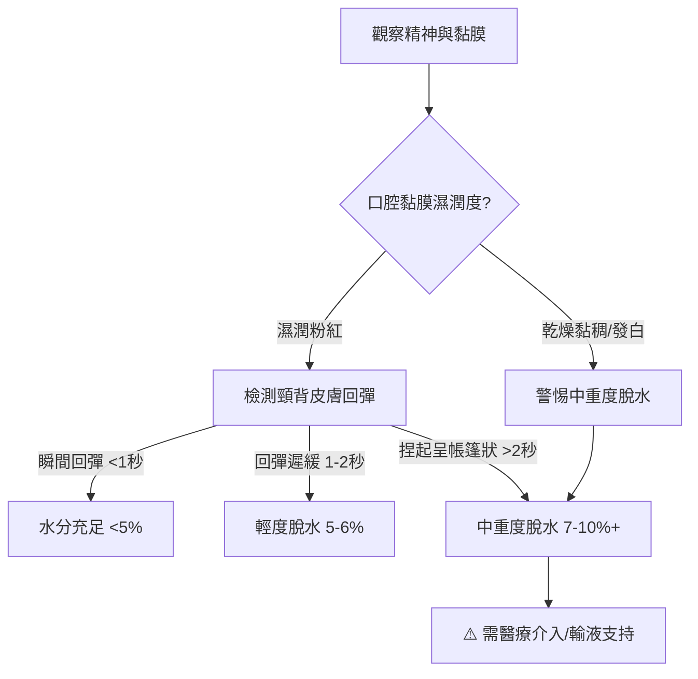

# 貓咪水分生理與脫水評估

貓咪源自沙漠環境的非洲野貓（*Felis lybica*），具有天生口渴感知遲鈍與超強尿液濃縮機能的生理特質。了解水分平衡是預防 [[貓下泌尿道疾病_FLUTD]] 與減緩 [[慢性腎臟病_CKD]] 的第一道防線。

---

## 一、 每日水分需求量計算 (Daily Fluid Requirement)

### 1. 體重快速換算法
成人維持期健康的成貓，每公斤體重每日需水量為：
$$\text{每日需水量 (mL)} = \text{體重 (kg)} \times 40 \sim 60 \text{ mL}$$

| 貓咪體重 | 每日基礎建議水量範圍 (mL/day) |
| :--- | :--- |
| **3 kg** | $120 \sim 180\text{ mL}$ |
| **4 kg** | $160 \sim 240\text{ mL}$ |
| **5 kg** | $200 \sim 300\text{ mL}$ |

### 2. 乾糧 vs 濕食（主食罐）水分貢獻對比
- **乾糧（含水約 10%）**：若全吃乾糧（每日 60g），從食物中僅攝取約 $6\text{ mL}$ 水分，剩餘 $150 \sim 230\text{ mL}$ 須百分之百仰賴主動飲水。
- **主食罐（含水約 80%）**：若全吃濕食（每日 180g），自然吃進約 $144\text{ mL}$ 水分，已滿足 $70\% \sim 90\%$ 的日需求，使尿液維持在低飽和度的安全區間。

---

## 二、 脫水程度臨床評估量表

當貓咪因嘔吐、腹瀉、多尿發作或中毒時，可依據下列步驟進行初步判定：

| 脫水等級 | 脫水比率 | 臨床徵象 | 居家與臨床應變對策 |
| :--- | :--- | :--- | :--- |
| **亞臨床** | $< 5\%$ | 外觀無異常，精神尚可 | 增加濕糧、補充流動活水 |
| **輕度脫水** | $5\% \sim 6\%$ | 頸背皮膚捏起後回彈稍慢；牙齦黏膜微黏 | 給予常溫無鹽肉湯、副食罐騙水 |
| **中度脫水** | $7\% \sim 9\%$ | 皮膚捏起回彈延遲（$>2$ 秒）；微血管充盈（CRT）$>2$ 秒；眼窩微凹 | **需就醫**：由獸醫師進行皮下輸液（SC Fluids） |
| **重度脫水** | $10\% \sim 12\%$ | 皮膚完全失去彈性呈現帳篷狀；四肢末端冰冷；脈搏弱而快 | **急症**：進入低血容休克前期，需急診靜脈點滴 |
| **危急** | $> 12\%$ | 意識昏迷、低體溫、血壓崩潰 | 立即進入加護搶救（ICU） |

---

## 三、 提升主動飲水實證技巧
1. **水碗位置分流**：嚴守「水碗、食碗、貓砂盆各自獨立」原則。遠離排泄物與氣味強烈的食物。
2. **器皿材質**：選用寬口淺底的陶瓷或食品級不鏽鋼容器，避免「鬍鬚疲勞（Whiskers Fatigue）」。
3. **流水誘惑**：擺設活水噴泉飲水機，利用動態水流激發好奇心。
4. **多點佈局**：在貓咪日常走道、臥榻邊設置多個飲水站。

---

## 相關頁面連結
- [[貓下泌尿道疾病_FLUTD]]：水分不足導致尿液結晶濃縮的直接後果。
- [[慢性腎臟病_CKD]]：多渴多尿與腎元脫水循環。
- [[貓咪急症紅旗信號總覽]]：中重度脫水與休克的緊急應變。
- [[健檢指標與臨床判讀基準]]：尿比重（USG）的臨床意義。
